# Hi, I'm Tolu 👋

<a href="https://git.io/typing-svg">
  <picture>
    <source media="(prefers-color-scheme: dark)" srcset="images/mdr/typing-svg-dark-ae9cd56b.svg" />
    <source media="(prefers-color-scheme: light)" srcset="images/mdr/typing-svg-light-9c1f1d3f.svg" />
    
  </picture>
</a>

  <a href="mailto:tolu+github@olagunju.ng">
    <picture>
      <source media="(prefers-color-scheme: dark)" srcset="images/mdr/email-dark-501c5024.svg" />
      <source media="(prefers-color-scheme: light)" srcset="images/mdr/email-light-31e254cb.svg" />
      
    </picture>
  </a>
  <a href="https://github.com/Powerisinschool?tab=repositories">
    <picture>
      <source media="(prefers-color-scheme: dark)" srcset="images/mdr/repositories-dark-77fb76da.svg" />
      <source media="(prefers-color-scheme: light)" srcset="images/mdr/repositories-light-12b26157.svg" />
      
    </picture>
  </a>

> *"You can never understand everything, but you should push yourself to understand the system."* - Ryan Dahl

---

### 👨‍💻 About Me

- ⚙️ **Systems First:** Building from first principles across OS kernels, browser layout engines, real-time WebRTC infrastructure, and embedded firmware.
- 🎓 **Education:** Pursuing a BSc in Computer Science at the University of London.
- 🤝 **Collaboration:** Always down to discuss low-level architecture, performance optimization, or interesting engineering problems.
- ♟️ **Off the Keyboard:** Passive chess player, football (soccer), and table tennis.
- ⚡ **Fun Fact:** Facts aren't fun! 😄

---

### 🚀 Featured Projects

| Project | Focus | Stack |
| :--- | :--- | :--- |
| **[`swish_kernel`](https://github.com/Powerisinschool/swish_kernel)** | 64-bit bare-metal x86_64 OS kernel with Limine bootloader, PS/2 driver, VFS, shell, and double-buffered GUI compositor | `C++` `x86_64 Assembly` |
| **[`blink-rs`](https://github.com/Powerisinschool/blink-rs)** | Minimal browser rendering engine inspired by Blink/LayoutNG with arena-allocated DOM, CSS parser, and fragment tree | `Rust` |
| **[`mdr`](https://github.com/Powerisinschool/mdr)** | Extended Markdown compiler with custom parsing logic, used to generate this very README | `Rust` |
| **`custom_gpt`** | Custom Large Language Model tokenizer and transformer inference engine built from scratch | `C++` |
| **ESP32-C6 Smart Lock** | Bare-metal (`no_std`) embedded firmware implementing ECDSA P-256 signature verification over TCP/LAN | `Rust` `Embedded` |

---

### 🛠️ Tech Stack

**Systems & Low-Level**

  <picture>
    <source media="(prefers-color-scheme: dark)" srcset="images/mdr/c-dark-9e0b314b.svg" />
    <source media="(prefers-color-scheme: light)" srcset="images/mdr/c-light-e9ee5f04.svg" />
    
  </picture>
  <picture>
    <source media="(prefers-color-scheme: dark)" srcset="images/mdr/cpp-dark-ba1efce8.svg" />
    <source media="(prefers-color-scheme: light)" srcset="images/mdr/cpp-light-89513901.svg" />
    
  </picture>
  <picture>
    <source media="(prefers-color-scheme: dark)" srcset="images/mdr/rust-dark-f8740319.svg" />
    <source media="(prefers-color-scheme: light)" srcset="images/mdr/rust-light-91865ebd.svg" />
    
  </picture>
  <picture>
    <source media="(prefers-color-scheme: dark)" srcset="images/mdr/go-dark-9b5ae643.svg" />
    <source media="(prefers-color-scheme: light)" srcset="images/mdr/go-light-a0c20337.svg" />
    
  </picture>
  <picture>
    <source media="(prefers-color-scheme: dark)" srcset="images/mdr/linux-dark-8ec70f64.svg" />
    <source media="(prefers-color-scheme: light)" srcset="images/mdr/linux-light-9c16cd74.svg" />
    
  </picture>

**Web & Application**

  <picture>
    <source media="(prefers-color-scheme: dark)" srcset="images/mdr/typescript-dark-9a231117.svg" />
    <source media="(prefers-color-scheme: light)" srcset="images/mdr/typescript-light-e6ba3f56.svg" />
    
  </picture>
  <picture>
    <source media="(prefers-color-scheme: dark)" srcset="images/mdr/javascript-dark-e67be307.svg" />
    <source media="(prefers-color-scheme: light)" srcset="images/mdr/javascript-light-7d6a6ff8.svg" />
    
  </picture>
  <picture>
    <source media="(prefers-color-scheme: dark)" srcset="images/mdr/astro-dark-71711fdf.svg" />
    <source media="(prefers-color-scheme: light)" srcset="images/mdr/astro-light-82076d7f.svg" />
    
  </picture>
  <picture>
    <source media="(prefers-color-scheme: dark)" srcset="images/mdr/react-dark-cd4428d0.svg" />
    <source media="(prefers-color-scheme: light)" srcset="images/mdr/react-light-2801077f.svg" />
    
  </picture>
  <picture>
    <source media="(prefers-color-scheme: dark)" srcset="images/mdr/angular-dark-be7a1b11.svg" />
    <source media="(prefers-color-scheme: light)" srcset="images/mdr/angular-light-4ebe1d59.svg" />
    
  </picture>
  <picture>
    <source media="(prefers-color-scheme: dark)" srcset="images/mdr/nodejs-dark-679eafb4.svg" />
    <source media="(prefers-color-scheme: light)" srcset="images/mdr/nodejs-light-ca44f4c2.svg" />
    
  </picture>
  <picture>
    <source media="(prefers-color-scheme: dark)" srcset="images/mdr/tailwindcss-dark-c01b5bc0.svg" />
    <source media="(prefers-color-scheme: light)" srcset="images/mdr/tailwindcss-light-d9a6bc8a.svg" />
    
  </picture>
  <picture>
    <source media="(prefers-color-scheme: dark)" srcset="images/mdr/dart-dark-544a50fd.svg" />
    <source media="(prefers-color-scheme: light)" srcset="images/mdr/dart-light-91fa3505.svg" />
    
  </picture>

**AI, Data & Infrastructure**

  <picture>
    <source media="(prefers-color-scheme: dark)" srcset="images/mdr/python-dark-eee76719.svg" />
    <source media="(prefers-color-scheme: light)" srcset="images/mdr/python-light-c401a649.svg" />
    
  </picture>
  <picture>
    <source media="(prefers-color-scheme: dark)" srcset="images/mdr/tensorflow-dark-4daf0baa.svg" />
    <source media="(prefers-color-scheme: light)" srcset="images/mdr/tensorflow-light-d954dff7.svg" />
    
  </picture>
  <picture>
    <source media="(prefers-color-scheme: dark)" srcset="images/mdr/keras-dark-023ba7e1.svg" />
    <source media="(prefers-color-scheme: light)" srcset="images/mdr/keras-light-67f0829d.svg" />
    
  </picture>
  <picture>
    <source media="(prefers-color-scheme: dark)" srcset="images/mdr/numpy-dark-debab072.svg" />
    <source media="(prefers-color-scheme: light)" srcset="images/mdr/numpy-light-1e4dd3bf.svg" />
    
  </picture>
  <picture>
    <source media="(prefers-color-scheme: dark)" srcset="images/mdr/pandas-dark-ba26f7ff.svg" />
    <source media="(prefers-color-scheme: light)" srcset="images/mdr/pandas-light-652b3629.svg" />
    
  </picture>
  <picture>
    <source media="(prefers-color-scheme: dark)" srcset="images/mdr/docker-dark-435c7b6d.svg" />
    <source media="(prefers-color-scheme: light)" srcset="images/mdr/docker-light-843fe4fc.svg" />
    
  </picture>
  <picture>
    <source media="(prefers-color-scheme: dark)" srcset="images/mdr/github-dark-a055faa9.svg" />
    <source media="(prefers-color-scheme: light)" srcset="images/mdr/github-light-91770718.svg" />
    
  </picture>

---

### 📈 GitHub Activity & Stats

  <a href="https://github.com/Powerisinschool">
    <picture>
      <source media="(prefers-color-scheme: dark)" srcset="https://github-readme-stats.vercel.app/api?username=Powerisinschool&hide_border=true&count_private=true&show_icons=true&bg_color=0D1117&title_color=14B8A6&icon_color=14B8A6&text_color=C9D1D9" />
      <source media="(prefers-color-scheme: light)" srcset="https://github-readme-stats.vercel.app/api?username=Powerisinschool&hide_border=true&count_private=true&show_icons=true&bg_color=F6F8FA&title_color=0F766E&icon_color=0F766E&text_color=24292F" />
      
    </picture>
  </a>
  <a href="https://github.com/Powerisinschool">
    <picture>
      <source media="(prefers-color-scheme: dark)" srcset="images/mdr/top-languages-dark-4175b381.svg" />
      <source media="(prefers-color-scheme: light)" srcset="images/mdr/top-languages-light-8c0da5ed.svg" />
      
    </picture>
  </a>

  <a href="https://github.com/Powerisinschool">
    <picture>
      <source media="(prefers-color-scheme: dark)" srcset="https://streak-stats.demolab.com/?user=Powerisinschool&hide_border=true&background=0D1117&ring=14B8A6&fire=14B8A6&currStreakLabel=14B8A6&sideLabels=C9D1D9&currStreakNum=FFFFFF&sideNums=FFFFFF&dates=8B949E" />
      <source media="(prefers-color-scheme: light)" srcset="https://streak-stats.demolab.com/?user=Powerisinschool&hide_border=true&background=F6F8FA&ring=0F766E&fire=0F766E&currStreakLabel=0F766E&sideLabels=24292F&currStreakNum=1F2328&sideNums=1F2328&dates=57606A" />
      
    </picture>
  </a>

  <picture>
    <source media="(prefers-color-scheme: dark)" srcset="https://github-readme-activity-graph.vercel.app/graph?username=Powerisinschool&bg_color=0D1117&color=C9D1D9&line=14B8A6&point=FFFFFF&area=true&area_color=14B8A6&hide_border=true" />
    <source media="(prefers-color-scheme: light)" srcset="https://github-readme-activity-graph.vercel.app/graph?username=Powerisinschool&bg_color=F6F8FA&color=24292F&line=0F766E&point=1F2328&area=true&area_color=14B8A6&hide_border=true" />
    
  </picture>

🌗 This profile adapts to your theme. Switch your system to light or dark mode to see it change.
